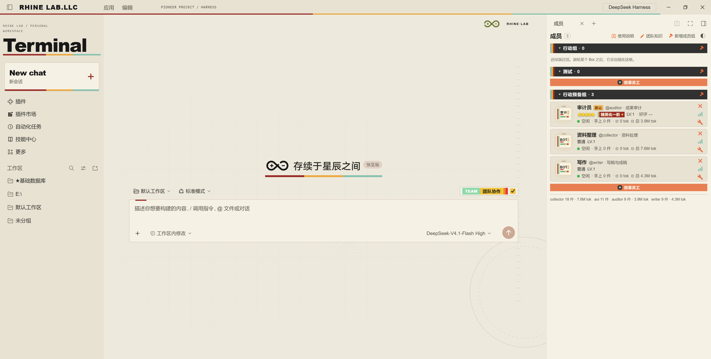
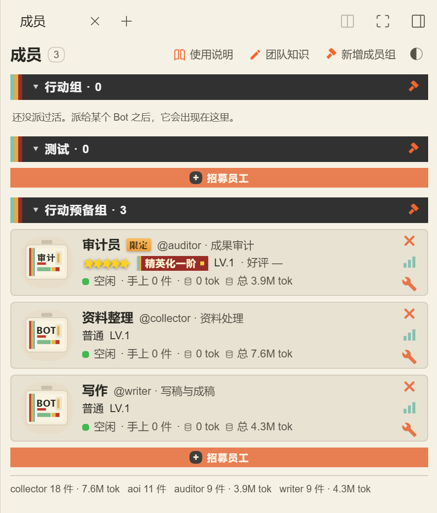

# dsh-rhine-lab-team

给 DeepSeek Harness 配一个工作团队：每个 Bot 有自己的记忆、分工、头像和 ID；在你的指导下或自己干活，都能积累经验、升级成长，成为你最放心可靠的团队成员。

> 灵感与视觉：产品灵感、成员卡/面板和「孤星」皮肤参考《明日方舟》。游戏及其角色、UI 素材版权归上海鹰角网络科技有限公司所有；本项目与鹰角网络无隶属或授权关系，仓库不附带游戏素材。

## 界面





Bot 不在主会话里发言——它们的话由秘书用 ` ```member ` 围栏块转述，客户端渲染成卡片。日志里始终只有秘书一个人在说话，所以 fork、回放、搜索、导出都不受影响；卸掉插件，卡片退化成一段 YAML。

## 安装

要求：DeepSeek Harness `0.2.2-rc.1` 及以上、Node.js `22.19` 及以上。

```sh
dsh plugin add dsh-rhine-lab-team
```

也可以从 GitHub 装：

```sh
dsh plugin add https://github.com/vioeveann/dsh-rhine-lab-team
```

装好后在插件列表里启用 `dsh-rhine-lab-team`；`dsh-avatar-frame` 作为依赖声明为 `latest`，安装或更新本插件时由包管理器解析最新版，已经是最新则不动。新开会话，在开始页或输入框下方打开「团队协作」开关，右侧栏出现「成员」面板。

第一次打开会自带三个 Bot：审计员、资料整理、写作。它们的定义在代码里，不随包附带任何个人或测试 Bot；交付目录默认是 `~/Documents/dsh-team-deliverables`（可在「团队设置」里改）。

## 推荐搭配

推荐和 `dsh-rhine-lab-theme` 主题插件一起用。界面是同一套莱茵生命配色，成员面板、任务卡和主界面看起来更统一；两个插件各自独立，不装主题也能正常用。

## 与同类插件的冲突

本插件会自动启用 `dsh-avatar-frame`（子会话头像与 ID 靠它）。如果同时装了别的**接管聊天头像/ID** 的插件（头像框、换头像、语音朗读类），两者会争同一个位置，表现为头像时有时无、或 ID 被换成对方的内容。

- 冲突时在插件页关掉其中一个，不要两个都开。
- 关掉 `dsh-avatar-frame` 不影响团队功能本身，只是子会话里看不到 Bot 的头像和 ID（会退回全局头像）。
- 本插件不自动改别人的设置，只插入自己的入口。

## 现状（2026-11-20）

能用了：

- **任务单**：结构化字段（目标 / 交付物 / 验收标准 / 红线 / 材料 / 交接来源）
- **派活** `team_dispatch`：拉起任务会话，人设 + 团队记忆 + soul + 底座规则注入，沙箱 `workspace-write`
- **续做** `continueFrom`：同一件成果的改 / 补 / 优化接回原会话，不新开；和上一件无关的新活照常新开
- **批量派活** `team_dispatch_many`：一次交多件活，可声明依赖；互不依赖的按并发上限并行，全部回来再汇总
- **任务依赖**：`dependsOn` 让一件活等上游跑完再开；上游失败/打回，下游直接记 `blocked`，不会 spawn
- **计划预览** `team_plan`：只出成员、任务单和预估耗时/token，不 spawn、不花 token，确认后再派
- **交接**：`fromTask` 把上一件的产物复制到新任务目录，一个 Bot 的活直接交给下一个
- **验收** `team_review`：通过 / 打回（打回必须写理由），可附核对依据 `evidence`；普通交付不强制审计，只有评 excellent 才必须有审计记录；一件活只验收一次，改判走 `team_user_feedback`
- **中止** `team_cancel`：掐断正在跑的活，账本记成「已取消」，不留 running 残行
- **任务看板**：面板可看全量账本、按状态筛，能一键清理待验收；任务卡显示耗时、token 和实际模型；单件任务可导出成 Markdown 记录
- **单聊回传**：直接和 Bot 聊天，那一轮也会记进账本（看板按 chat 筛）
- **多团队**：每个会话单独选队伍，不在队伍里的 Bot 派不出去
- **重试**：按原任务单重派——工具 `team_retry`（自动带上上一轮验收/审计意见，并在**原会话**里返工；原会话接不上才新开），或面板任务详情里的「按原单重派」
- **产物** `team_collect`：草稿收进交付目录（位置可在面板「团队设置」里改），跳过 `from-previous/` 与 `raw/`
- **记忆**：`team_recall` / `team_memory_append` / 快照 / 回退，每写一次自动 git 提交
- **团队记忆**：面板里直接编辑 `knowledge.md`（团队知识库，事实与口径）和 `user.md`（关于你），所有 Bot 和秘书都读；`style.md`（写作规矩）仍会注入，只是不再从面板改
- **成长与晋升**：普通 Lv1–20 → 精英化一阶 Lv1–50 → 精英化二阶 Lv1–90；经验来自被验收的活、教学和复犯，教过的规矩守住 2 件活可以确认一次 +120；评分率与复犯率只在精英化段显示；满级后卡片上出现「可晋升 ▲」
- **晋升感言** `team_promote`：晋升后 Bot 按自己的人设写两三句，面板弹绿底卡片；秘书也可以转述成卡片
- **全员底座**：一段隐藏的运行规则（服从与上报 / 诚实 / 红线 / 成长），每个 Bot 都带，人设改不掉
- **token 用量**：卡片上显示真实用量（本次会话 / 合计），口径和主会话一致（输入 + 输出 + 缓存读）；任务详情、统计、导出记录都带拆分明细
- **能力卡**：面板里填 allow / deny，按 Bot 收窄工具
- **体检** `team_health`：在跑、待验收、卡住，并指出最慢的一件
- **监考**：子会话 180 秒没有新动作就问「是不是卡住了」；没回答就再问一次；两次都没回答、日志也完全不动，就停掉当前 turn 再问它卡在哪；回答正常就每 5 分钟再问，封顶 10 次交给你判断；回答卡住让它自己修。同一工具同一组参数反复调用会提醒换路，8 次判打转
- **设置**：称谓 / 并发（同时跑的子智能体数）/ 单任务最长运行 / 交付目录，面板改完下一次派活生效。卡住提醒（第一次询问、再问间隔、等回答宽限）仍在设置里，只是面板不摆出来。
- **统计**：每个 Bot 干了多少件、花了多少 token、通过多少
- **成员组**：橙色锤子建组；每个组卡片最右边的锤子在组下面展开团队设置（同一个编辑器），顶部多一行「这个组」可以改名或删掉它
- **界面**：成员面板（分组折叠、卡片扳手改成员、组内招募、头像裁剪、点卡片开子会话、任务详情、成长与晋升、橙色锤子进团队设置）、皮肤 classic / aurora
- **子会话身份**：依赖 `dsh-avatar-frame`（声明为 `latest`，npm 上需 ≥ 0.15）时显示 Bot 自己的头像和 ID，点它进设置，语音关闭
- **测试**：308 条（`npm test`）+ 2 条浏览器冒烟测试（`test/e2e`）

## 任务依赖

有先后关系的活，用 `dependsOn` 串起来：

- 单件：`team_dispatch` 加 `dependsOn: ["t-abc"]`（JSON 数组或逗号分隔的任务号）。
- 批量：`team_dispatch_many` 里每项可加 `key` 当批内别名，另一些项用 `dependsOn: ["collect"]` 等 key 引用，不必先知道任务号。
- 上游默认 `ready` 就放行；加 `dependsOnMode: "accepted"` 后，必须验收通过才放行。
- 上游 `failed` / `rejected` / `timeout` / `blocked`，下游记 `blocked`，原因写进账本和任务详情，不会拉起子会话。
- 批量可加 `chainTimeoutSec`，整条链超时后没开始的任务直接 `blocked`；`team_cancel` 传 `chain: true` 可整链中止。
- 排队等依赖的任务不占并发名额；DSH 重启时没开始的 `queued` 会自动恢复，跑到一半的标 `interrupted`，在任务详情点「恢复整链」按原单续跑或重派。
- 面板「最近任务」右侧有「依赖图」，按链画出节点和箭头，只读。

## 成员信箱

Bot 之间可以绕过秘书直接对齐：

- `team_send`：发给团队里另一个已启用的 Bot；正文必填，可带主题、`threadId`、`taskId`。
- `team_inbox`：看自己的收件箱；秘书可以指定 `bot` 查看某个 Bot 的信箱。
- `team_reply`：沿已有线程回复，收件人自动判断。

信是持久化的，但不会叫醒空闲 Bot：接收方下次开始任务时，未读消息会随任务单注入。秘书在面板点名字旁的小信封只能只读查看，不算 Bot 已读；只有 Bot 自己调用 `team_inbox` 才标已读。第一版没有回复框，Bot 看完仍把结论写回任务结果。

## 反馈

遇到 bug、觉得哪里不好用，欢迎开 Issue：<https://github.com/vioeveann/dsh-rhine-lab-team/issues>。也欢迎直接提意见，不用客气。

英文版（README 与界面）在计划中。

## 目录

```
index.js            Host 半区加载器（改它要重启）
host/runtime.js     装配：路由、工具、装饰器
host/tools.js       派活、验收、记忆、晋升与感言
host/growth.js      成长公式与晋升判定；host/speech.js 感言提示词与清洗
host/base-rules.js  全员底座规则（隐藏，优先于人设）
host/team-mode.js   开关与名册的 HTTP 接口
client.js           Client 半区，客户端唯一源码（含成员面板）
bots/<id>/          名册（bots/<id>.json）与记忆（memory/，本身是 git 仓库）
docs/               设计说明、交接、发布、运行时笔记、皮肤 token
test/               node --test
```

## 开发

```sh
npm test                        # Node 侧全部测试
npm run check                   # 跨平台语法检查
```

`client.js` 是客户端唯一源码，面板直接写在里面。`src/client/members.js` 与 `scripts/inline-members.mjs` 是早期的内联工具，源码已落后，**不要再跑**（跑会把面板写回旧版）。

主机代码改动后关开一次插件即可生效；`index.js` 改动需要重启，客户端改动需要刷新页面。
